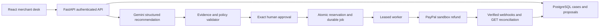

# Architecture

## Request flow

## Data records

`payments` stores app-owned order and capture IDs, source/environment, cents, reservations, and a monotonic version. `cases` stores customer text and the requested amount. `proposals` stores immutable analysis, exact citations, policy hash, payment version, and fingerprint. `refunds` stores approval-linked operation identity, fixed API payload, request UUID, provider ID, result, and reservation state. `jobs` stores due time, attempts, claim token, and lease expiry. `webhooks` stores only verified events, uniquely keyed by provider event ID. `audit` records business events. `quotas` bounds daily AI requests before calling the model.

## API

- `GET /api/config`: public configuration status; never secrets.
- `POST /api/session`, `DELETE /api/session`: merchant login/logout.
- `GET /api/dashboard`: authenticated payments, cases, refund states, audit.
- `POST /api/demo/orders`: fixed $20 demo purchase; server decides price.
- `POST /api/demo/orders/{payment_id}/capture`: capture an app-owned, buyer-approved order using a stored request UUID.
- `POST /api/cases`: payment ID, customer statement, positive integer requested cents.
- `POST /api/cases/{id}/analyze`: structured AI or explicitly labelled rules preview. A new analysis supersedes older ready proposals.
- `POST /api/proposals/{id}/approve`: accepts only `{fingerprint, confirmed}`; the stored proposal supplies all financial parameters.
- `POST /api/refunds/{id}/reconcile`: requeues the existing operation; never creates another UUID.
- `POST /api/paypal/webhook`: real sandbox signature verification, durable event deduplication, asynchronous reconciliation.
- `GET /health`: process/database readiness, without private data.

## Authentication and trust boundaries

An HTTP-only, signed 12-hour cookie identifies the single merchant. CSRF token/header matching and exact Origin checks protect mutations. HTTPS makes the cookies Secure. React escapes all customer/model strings. APIs do not accept arbitrary capture IDs or client-selected payment amounts. Sandbox API origin is hardcoded; there is no live-mode option.

The AI receives only synthetic policy, selected payment facts, and customer text. It never receives API credentials or a financial write tool. A schema checks types, an exact-quotation check grounds citations, and independent deterministic policy controls gate approval.

## State and recovery

- Approval atomically reserves the approved cents and increments the payment version; competing stale proposals fail.
- Jobs are claimed with a lease token and expire after a crash. PostgreSQL uses row locking with skip-locked; conditional updates also guard SQLite previews.
- The worker rechecks the capture before the first attempt. Once an attempted POST may have succeeded, recovery uses the original payload and UUID without creating a fresh financial instruction.
- `PENDING` is not success. An unknown outcome holds the reservation. Five uncertain submission attempts, or 44 elapsed days without an ID, stop automatic resubmission before the documented provider retention boundary.
- Known refund IDs are reconciled through GET. Confirmed terminal states settle/release the reservation atomically once.
- Webhooks are notifications, not commands. Current PayPal representations decide status. Pending captures also get durable reconciliation jobs.

## Operations

Deploy one service process with a persistent PostgreSQL database; the filesystem is expendable. Database schema is managed by Alembic. The worker resumes after deploys. `/health` is the hosting health check. Monitor job failures, unresolved refunds, AI quota exhaustion, and database usage through service logs and the app audit trail. Logs contain operation identifiers, not passwords or tokens.

If an operation remains unknown: inspect the PayPal sandbox merchant dashboard and its request/refund IDs. Use **Check status** for an existing known provider ID. Do not issue another refund or clear its reservation merely to make the UI look successful. Reconcile against authoritative PayPal records first.
